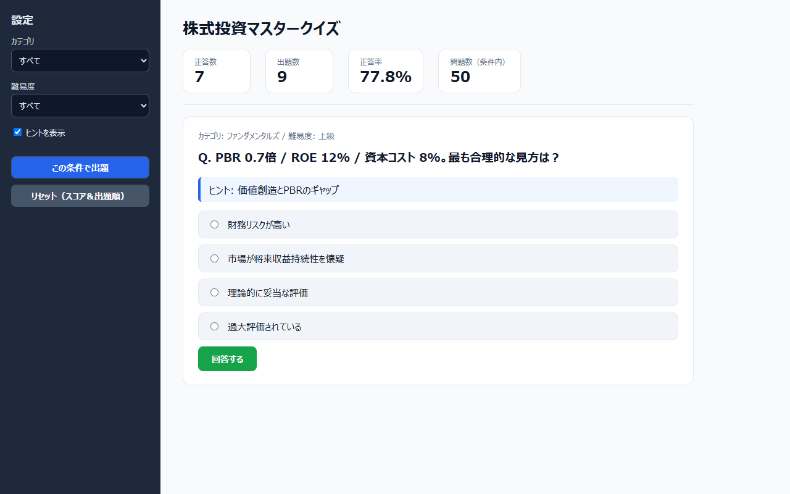
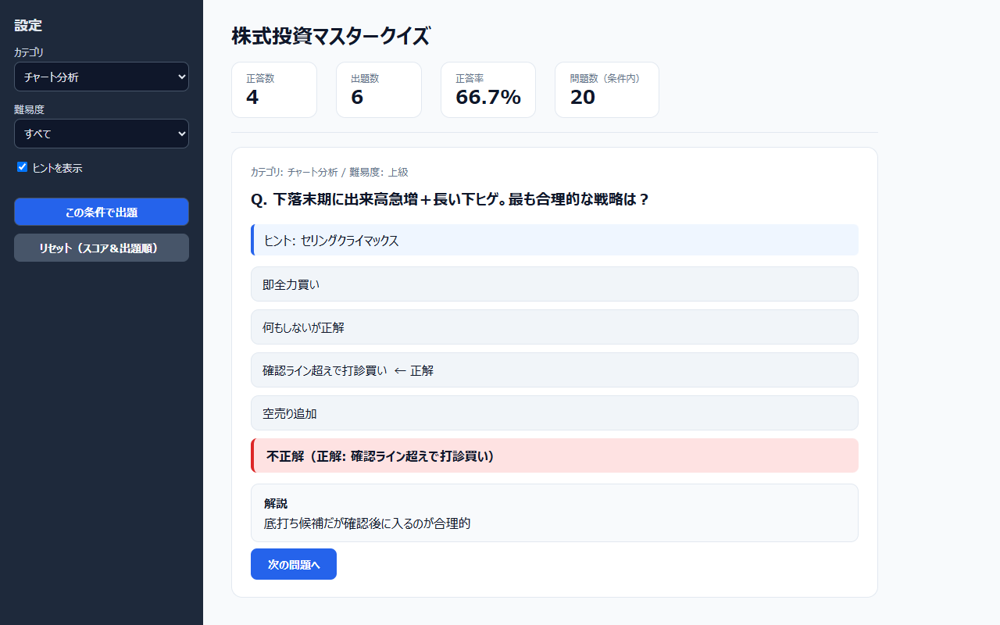
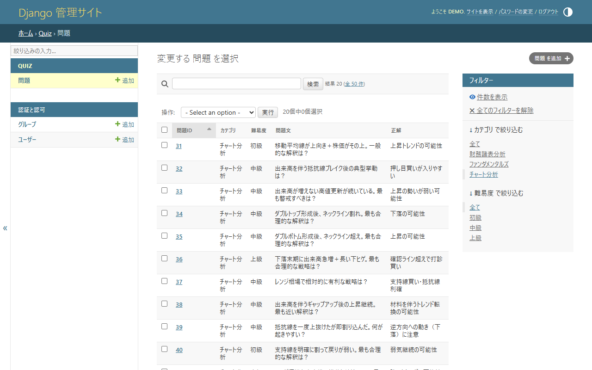
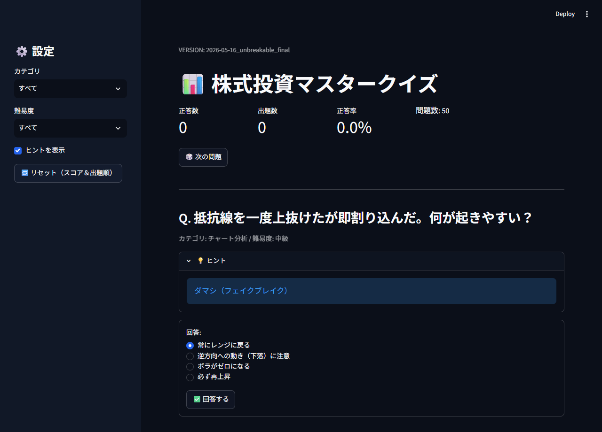

# 株式投資マスタークイズ（Stock Quiz App）

財務諸表分析・ファンダメンタルズ・チャート分析の 4 択問題 50 問で、株式投資の基本的な考え方を学べるクイズアプリです。現在のメインは Django 版（`stock_quiz/`）で、移植元の Streamlit 版（`app.py`）も同じリポジトリで動かせます。


> **English summary:** A Japanese quiz app for learning the basics of stock investing: 50 multiple-choice questions on financial statement analysis, fundamentals, and chart (technical) analysis, with category/difficulty filters, optional hints, explanations, and a running score. The main version is a Django app in `stock_quiz/` (questions are imported into SQLite and can be edited in the Django admin). The original Streamlit version (`app.py`) is kept at the repository root. For educational purposes only; not investment advice.

<p align="center"></p>

## 目次

- [主な機能](#主な機能)
- [Django 版と Streamlit 版の違い](#django-版と-streamlit-版の違い)
- [問題データ](#問題データ)
- [クイックスタート](#クイックスタート)
- [使い方](#使い方)
- [技術スタック](#技術スタック)
- [プロジェクト構成](#プロジェクト構成)
- [設計のポイント](#設計のポイント)
- [テスト](#テスト)
- [本番環境で使うとき](#本番環境で使うとき)
- [既知の制限と今後の改善候補](#既知の制限と今後の改善候補)
- [データと免責](#データと免責)

## 主な機能

- **50 問の 4 択クイズ**：財務諸表分析・ファンダメンタルズ・チャート分析の 3 カテゴリ、初級・中級・上級の 3 段階です。
- **出題範囲の絞り込み**：カテゴリと難易度を選んで出題できます（どちらも「すべて」を選べます）。
- **重複しない出題順**：条件に合う問題をシャッフルして 1 問ずつ出し、すべて出し終えると並べ直して次の周に入ります。
- **選択肢のシャッフル**：問題ごとに 1 回だけ並べ替えて保存するため、画面を再読み込みしても並び順は変わりません。
- **ヒントと解説**：ヒントは表示・非表示を切り替えられます。回答すると正誤・正解・解説が表示されます。
- **スコア表示**：正答数・出題数・正答率と、条件に合う問題数を表示します。スコアと出題順はボタン 1 つでリセットできます。
- **問題の管理（Django 版）**：問題は SQLite に保存され、Django 管理画面で一覧・検索・絞り込み・編集ができます。`questions.json` からの取り込みは管理コマンド 1 つで行えます。

## Django 版と Streamlit 版の違い

どちらも同じ問題データを使い、出題・採点の流れも共通です。Django 版は Streamlit 版の出題ロジックを移植したもので、現在はこちらがメインです。

| 項目 | Django 版（メイン） | Streamlit 版（移植元） |
| --- | --- | --- |
| 場所 | `stock_quiz/` | リポジトリ直下の `app.py` |
| 問題の読み込み | `stock_quiz/questions.json` を SQLite に取り込んで使う | 起動時に `questions.json` を直接読み込む |
| スコア・出題順の保存先 | Django のセッション（SQLite）。再読み込みしても続きから再開 | Streamlit のセッション（メモリ）。再読み込みするとリセット |
| 条件を変えたとき | 「この条件で出題」で出題順を作り直し、すぐに新しい問題を表示 | 表示中の問題はそのまま。次の問題に進むときから反映 |
| 回答前の選択肢 | 未選択（選ばずに送信するとブラウザが選択を求める） | 先頭の選択肢が選ばれた状態 |
| ヒントの表示 | 問題文の下に表示 | 「ヒント」の折りたたみを開くと表示 |
| 回答せずに次へ進む | 専用のボタンなし | 上部の「次の問題」ボタン（スコアには数えない） |
| 問題の編集 | Django 管理画面（`/admin/`） | `questions.json` を編集（または `questions.csv` から変換） |
| 必要なパッケージ | `requirements.txt`（Django のみ） | streamlit・pandas・matplotlib（個別にインストール） |
| 画面のテーマ | ライト（テンプレート内の CSS） | ダーク（`.streamlit/config.toml`） |

## 問題データ

収録問題は 50 問です。リポジトリ直下の `questions.json`（Streamlit 版用）と `stock_quiz/questions.json`（Django 版の取り込み用）は同じ内容です。

| カテゴリ | 初級 | 中級 | 上級 | 合計 | 主なテーマ |
| --- | ---: | ---: | ---: | ---: | --- |
| 財務諸表分析 | 1 | 9 | 5 | 15 | 利益と営業 CF のずれ、売掛金・在庫、自己資本比率、のれん減損、EBITDA |
| ファンダメンタルズ | 0 | 10 | 5 | 15 | PER・PBR・ROE、ROIC と WACC、DCF、配当の持続性、金利・景気の局面 |
| チャート分析 | 2 | 13 | 5 | 20 | 移動平均線、出来高を伴うブレイク、ダブルトップ／ボトム、RSI、ボリンジャーバンド |
| **合計** | **3** | **32** | **15** | **50** | |

- どの問題も、問題文・選択肢 4 つ・正解・ヒント・解説がそろっています。
- チャート分析の問題は、値動きを文章で説明する形式です。現在のデータには、チャート画像やチャート描画用の数値データは含まれていません。
- ファンダメンタルズの初級問題はないため、「ファンダメンタルズ」と「初級」を組み合わせると「表示できる問題がありません」と表示されます。
- データ形式と、問題を追加・修正する手順は [docs/DEVELOPMENT.md](docs/DEVELOPMENT.md) にまとめています。

## クイックスタート

### 前提

- Python 3.12 以上（動作確認は Python 3.13）
- Git

### 1. リポジトリの取得と仮想環境の作成

**Windows（PowerShell）**

```powershell
git clone https://github.com/rebelnaoto7/stock_quiz_app.git
cd stock_quiz_app
python -m venv .venv
.\.venv\Scripts\Activate.ps1
```

`Activate.ps1` の実行時に「このシステムではスクリプトの実行が無効になっている」というエラーが出る場合は、次のコマンドで現在の PowerShell ウィンドウに限って実行を許可してから、もう一度有効化してください。

```powershell
Set-ExecutionPolicy -Scope Process -ExecutionPolicy RemoteSigned
```

**macOS / Linux**

```bash
git clone https://github.com/rebelnaoto7/stock_quiz_app.git
cd stock_quiz_app
python3 -m venv .venv
source .venv/bin/activate
```

### 2. Django 版（メイン）を起動する

仮想環境を有効にした状態で、リポジトリ直下から実行します（Windows・macOS・Linux 共通）。

```bash
pip install -r requirements.txt
cd stock_quiz
python manage.py migrate
python manage.py import_questions
python manage.py runserver
```

ブラウザで http://127.0.0.1:8000/ を開くと、すぐに 1 問目が表示されます。

- `migrate` で SQLite のデータベース（`stock_quiz/db.sqlite3`）が作られ、`import_questions` で `stock_quiz/questions.json` の 50 問が取り込まれます（「取り込み完了: 新規 50 件 / 更新 0 件（合計 50 問）」と表示されます）。
- `import_questions` は何度実行しても、同じ ID の問題が上書きされるだけで重複しません。
- ポート 8000 が使用中の場合は、`python manage.py runserver 8080` のように別のポートを指定してください。

管理画面を使う場合は、`stock_quiz/` で管理ユーザーを作成してから、http://127.0.0.1:8000/admin/ にログインします。

```bash
python manage.py createsuperuser
```

### 3. Streamlit 版（移植元）を起動する

`requirements.txt` には Django しか含まれていないため、Streamlit 版に必要なパッケージは個別にインストールします。`app.py` は実行時のカレントディレクトリにある `questions.json` を読み込むので、**リポジトリ直下**で実行してください（Django 版の手順のあとなら `cd ..` で戻ります）。

```bash
pip install streamlit pandas matplotlib
streamlit run app.py
```

ブラウザで http://localhost:8501/ を開きます。

- 初めて Streamlit を使う環境では、ターミナルでメールアドレスの入力を求められることがあります。入力は任意で、何も入力せずに Enter キーを押せば起動が続きます。
- 初回はライブラリの準備（matplotlib のフォントキャッシュ作成など）のため、画面が表示されるまで少し時間がかかることがあります。
- ポートを変える場合は `streamlit run app.py --server.port 8502` のように指定します。

### 動作確認した環境

Windows 11、Python 3.13.15、Django 6.1.2、Streamlit 1.66.1、pandas 3.1.0、matplotlib 3.11.2 で、上記の手順どおりに起動・操作できることを確認しています（2026 年 11 月）。macOS / Linux 向けのコマンドは一般的な手順として記載しており、実機では確認していません。

## 使い方

### Django 版

1. 左のサイドバーで「カテゴリ」「難易度」「ヒントを表示」を選び、「この条件で出題」を押します。出題順は作り直されますが、スコアはそのまま残ります。
2. 選択肢を 1 つ選び、「回答する」を押します。
3. 「正解」または「不正解（正解: ○○）」の表示、正しい選択肢に付く「← 正解」の印、解説が表示されます。「次の問題へ」で次に進みます。
4. 「リセット（スコア＆出題順）」を押すと、スコアと出題順が初期化されます。カテゴリ・難易度・ヒントの設定はそのまま残ります。

<p align="center"></p>

**管理画面（`/admin/`）**

`createsuperuser` で作成したユーザーでログインすると、「問題」の一覧で ID・カテゴリ・難易度・問題文・正解を確認できます。カテゴリ・難易度での絞り込み、問題文・正解・解説のキーワード検索、問題の追加・編集・削除ができます。

<p align="center"></p>

### Streamlit 版

<p align="center"></p>

操作の流れは Django 版と同じです（サイドバーで条件を選ぶ → 選択肢を選んで「回答する」→ 正誤と解説を確認 →「次の問題へ」）。上部の「次の問題」ボタンを押すと、回答せずに次の問題へ進めます（スコアには数えません）。そのほかの違いは「[Django 版と Streamlit 版の違い](#django-版と-streamlit-版の違い)」の表を参照してください。

## 技術スタック

| 区分 | 使用技術 |
| --- | --- |
| 言語 | Python 3.12 以上 |
| Django 版 | Django（`requirements.txt` は `Django>=5.2`。動作確認は 6.1.2）、SQLite、Django テンプレート（JavaScript は使っていません） |
| Streamlit 版 | Streamlit、pandas・matplotlib（財務データの表とチャートの描画用。`app.py` の起動に必要） |
| テスト | pytest（問題データの検証） |

## プロジェクト構成

主なファイルのみ記載しています（`__init__.py` などは省略）。

```text
stock_quiz_app/
├── stock_quiz/                        # Django 版（メイン）
│   ├── manage.py
│   ├── questions.json                 # 取り込み用の問題データ（ルートの questions.json と同じ内容）
│   ├── stock_quiz/                    # プロジェクト設定（settings.py, urls.py, wsgi.py, asgi.py）
│   └── quiz/                          # クイズアプリ
│       ├── models.py                  # Question モデル（1 問 = 1 レコード）
│       ├── views.py                   # 出題・採点・絞り込み・リセット（状態はセッションで管理）
│       ├── urls.py                    # "/" をクイズ画面に割り当て
│       ├── admin.py                   # 管理画面の一覧・絞り込み・検索の設定
│       ├── templates/quiz/quiz.html   # クイズ画面（CSS もこのファイル内）
│       ├── management/commands/
│       │   └── import_questions.py    # questions.json を DB に取り込むコマンド
│       ├── migrations/0001_initial.py
│       └── tests.py                   # 雛形のみ（テスト未実装）
├── app.py                             # Streamlit 版（移植元）
├── .streamlit/config.toml             # Streamlit 版のテーマ設定（ダーク）
├── questions.json                     # 問題データ（Streamlit 版が読み込む）
├── questions.csv                      # 問題データの元表（convert.py で questions.json に変換）
├── convert.py                         # questions.csv → questions.json の変換スクリプト
├── tests/
│   └── test_questions.py              # questions.json の検証テスト（pytest）
├── assets/                            # チャート問題用の画像 6 枚（旧バージョンで使用。現在は未使用）
├── utils/                             # チャート描画・成績保存の関数（現在のアプリからは未使用）
├── scripts/generate_charts.py         # メッセージを表示するだけのスクリプト
├── fix_chart_japanese_font.py         # assets/ のチャート画像を日本語フォントで再生成
├── apply_v2_1_patch.py                # 旧バージョン（v2.1）向けの修正スクリプト
├── results.csv                        # 旧バージョンが記録した成績（現在のアプリは読み書きしない）
├── docs/                              # README 用の画像、開発メモ（DEVELOPMENT.md）
├── requirements.txt                   # Django>=5.2 のみ
├── README.md
└── .gitignore
```

保守用スクリプトの詳しい動作や、開発の経緯は [docs/DEVELOPMENT.md](docs/DEVELOPMENT.md) を参照してください。

## 設計のポイント

- **Streamlit 版のロジックをそのまま移植**：Streamlit の `st.session_state` に置いていた出題キュー・固定した選択肢・回答フェーズ・スコアなどを、Django の `request.session` に置き換えています。`ss_init`・`pick_next_question` などの関数名も両版で共通です。
- **出題キュー**：「カテゴリ・難易度・該当件数」を組み合わせたキーを持ち、キーが変わったとき（条件の変更や問題の追加・削除）とキューが空になったときに、該当する問題 ID をシャッフルしてキューを作り直します。そのため、1 周するまで同じ問題は出ません。
- **二重採点の防止**：「回答前」と「回答後」の 2 つのフェーズを持ち、採点は回答前のフェーズで 1 回だけ行います。Django 版はフォーム送信のたびにリダイレクトする（PRG パターン）ため、ブラウザで再読み込みしてもフォームは再送信されません。
- **テンプレートに比較を書かない**：Django 版では、選択状態や正解の判定（`==` による比較）をすべてビューで済ませ、テンプレートには結果のフラグだけを渡しています。
- **取り込み時の検証**：`import_questions` は、Streamlit 版の読み込み時チェック（必須キー、ID の重複、選択肢が 2 つ以上あるか、正解が選択肢に含まれるか）を引き継いでいます。

## テスト

### 問題データのテスト（pytest）

`tests/test_questions.py` は、リポジトリ直下の `questions.json` を検証する pytest のテストです。pytest は `requirements.txt` に含まれていないため、別途インストールします。リポジトリ直下で実行してください。

```bash
pip install pytest
python -m pytest tests
```

2026 年 11 月時点の実行結果は **5 件中 4 件成功・1 件失敗**（`1 failed, 4 passed`）です。

| テスト | 結果 | 確認内容 |
| --- | --- | --- |
| `test_questions_json_exists_and_is_list` | 成功 | `questions.json` が配列で、20 問以上ある |
| `test_required_fields_exist` | **失敗** | 必須項目に `title`・`point` を含むが、現在のデータにはない（旧バージョンのデータ形式を前提にしたテスト） |
| `test_answer_exists_in_options` | 成功 | 正解が選択肢に含まれる |
| `test_difficulty_values_are_valid` | 成功 | 難易度が初級・中級・上級のいずれか |
| `test_image_files_exist_when_specified` | 成功 | `image`・`answer_image` が指定されていれば画像ファイルが存在する（現在のデータには指定なし） |

### Django 版

```bash
cd stock_quiz
python manage.py check
python manage.py test
```

`check` は「System check identified no issues (0 silenced).」となります。`quiz/tests.py` は雛形のみのため、`test` は 0 件（「Ran 0 tests」）です。

### 手動での動作確認

README 作成時に、次の点を HTTP リクエストとブラウザ操作で確認しました。

- Django 版：50 問を出し終えるまで同じ問題が出ないこと（51 問目から次の周）、再読み込みしても選択肢の並びが変わらないこと、回答を二重に送信してもスコアが増えないこと、絞り込み・ヒントの非表示・リセット
- Streamlit 版：正解・不正解の表示とスコア、再描画しても選択肢の並びが変わらないこと、絞り込み（財務諸表分析の 15 問が重複なく出ること）、「次の問題」によるスキップ、リセット

## 本番環境で使うとき

Django 版の設定（`stock_quiz/stock_quiz/settings.py`）は、`startproject` で生成された開発用の値のままです。インターネットに公開する場合は、少なくとも次の点を変更してください。

- `SECRET_KEY`：リポジトリに含まれている値は使わず、新しく生成した値を環境変数などから読み込む
- `DEBUG`：`False` にする
- `ALLOWED_HOSTS`：公開するドメイン名を設定する
- 静的ファイル：`STATIC_ROOT` を設定して `python manage.py collectstatic` を実行し、Web サーバーなどから配信する（`DEBUG = False` では、管理画面の CSS などを `runserver` が配信しなくなるため）
- アプリケーションサーバー：`runserver` は開発用です。`wsgi.py` または `asgi.py` を使い、WSGI / ASGI サーバーで動かす
- データベース：既定は SQLite（`stock_quiz/db.sqlite3`）で、セッション（スコアと出題順）もここに保存されます。期限切れのセッションは `python manage.py clearsessions` で削除できます

Streamlit 版を公開する場合は、現在の `requirements.txt` に streamlit・pandas・matplotlib が含まれていない点に注意してください。

## 既知の制限と今後の改善候補

### 既知の制限

- `tests/test_questions.py` の 1 件が失敗します（旧データ形式の `title`・`point` を必須としているため）。また、Django 版の自動テストはまだありません。
- `requirements.txt` には Django のみが書かれており、Streamlit 版と pytest は個別にインストールする必要があります。
- 問題データが `questions.json` と `stock_quiz/questions.json` の 2 か所にあり、変更するときは両方をそろえる必要があります。
- チャート分析は文章題のみです。`assets/` のチャート画像は、現在のどちらの版からも表示されません。また、Django 版はチャート用の数値データ（`chart_data`）や財務データ（`financial_data`）を画面に表示しません。
- Django 版の回答後の画面では、正解の選択肢を緑色にするスタイル（`.opt-answer`）が `.options label` のスタイルに上書きされて効いていません（「← 正解」の印で判別できます）。
- 回答履歴は保存されません。スコアはセッションの中だけで管理され、`results.csv` も現在のアプリでは使われていません。
- 回答後に自動で次の問題へ進む機能は、Django 版にはなく、Streamlit 版では既定で無効です。Streamlit 版の `AUTO_ADVANCE` を `True` にすると自動で進みますが、正誤と解説が表示されないまま次の問題に切り替わります。

### 今後の改善候補

- テストを現在のデータ形式に合わせて直し、Django 版のビューと取り込みコマンドのテストを追加する
- Streamlit 版とテスト用の依存パッケージを、別の requirements ファイルなどで明示する
- 問題データを 1 か所にまとめる
- `assets/` の画像や `chart_data` を使った、図付きのチャート問題を追加する
- 回答履歴の保存と、カテゴリ別の正答率の表示

## データと免責

- 問題と解説は、一般的な財務分析・企業価値評価・テクニカル分析の考え方を学ぶためのものです。問題文に出てくる企業（A 社・B 社など）は架空の例で、実際の市場データや外部 API は使っていません。
- 選択肢と解説は一般論を簡潔にまとめたもので、すべての相場状況に当てはまるわけではありません。
- 本アプリは投資の学習を目的としたもので、特定の銘柄や売買を推奨するものではありません。投資の判断はご自身の責任で行ってください。
